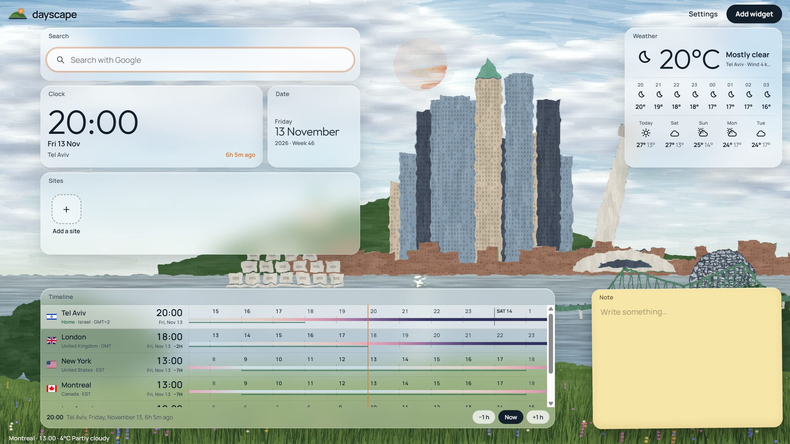
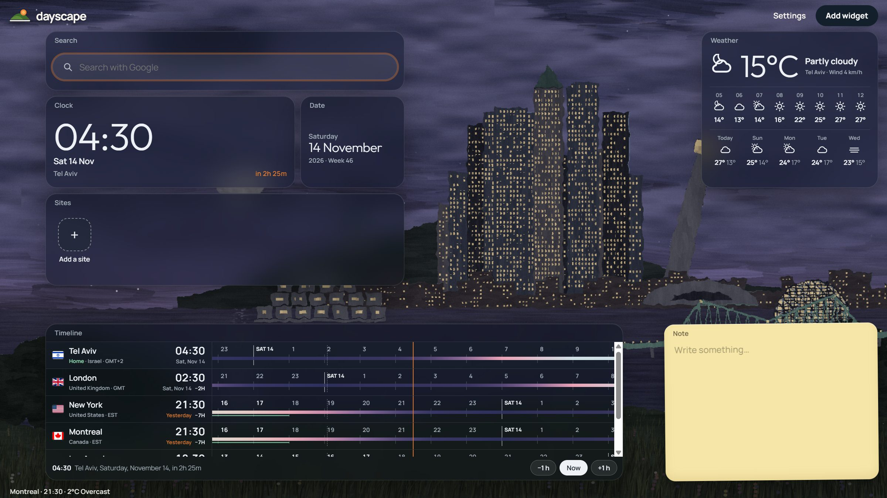

# Dayscape

A browser home page made of widgets you arrange yourself, set over a living painted landscape. The painting follows the real time of day and the real weather of the place it shows.

**Live:** https://taflynx.github.io/dayscape/





## Widgets

Drag a widget by its header to move it. Drag its bottom-right corner to resize it. The gear opens its settings. Everything is saved in your browser.

- **Search** with the engine you choose
- **Sites**: your favourite sites as tiles
- **Clock**, with an optional date in the format you like
- **Date**: weekday, date and week number, or a single date format
- **World clocks**, analog or digital
- **Timeline**: your places side by side on one strip of hours, which you can drag through the day
- **Weather**: now, the next hours and the next days
- **Calendar**
- **Sun and moon**: sunrise, sunset and the moon's phase
- **Meeting planner**: the best times today when all your places are at work
- **Timer**: a countdown or a Pomodoro
- **Currency** converter on European Central Bank rates
- **Notes**: sticky notes that float above the board. Use + on a note to add another.
- **To-do** list

Widgets come in clear glass by day and smoked glass at night. You can also fix the look to light or dark in Settings. Any widget except a note can have a transparent background.

## Make it your home page

- **Chrome:** Settings → On startup → Open a specific page → add `https://taflynx.github.io/dayscape/`. To also open it on new tabs, use a new-tab extension that opens a custom URL.
- **Edge:** Settings → Start, home, and new tabs → Open these pages → add the address.
- **Firefox:** Settings → Home → Homepage and new windows → Custom URLs → add the address.

## How it works

Plain HTML, CSS and JavaScript modules, with no build step and no server. The background is drawn with WebGL2. The meadow is painted live in brush strokes. Each city is four impasto oil paintings of one view, for morning, day, sunset and night, that fade into each other with the real sunrise and sunset. The sky, the river and the grass keep moving in the wind, and rain and snow fall over everything. Your board, places and notes live in your browser's local storage. Settings → Backup saves them to a file you can restore elsewhere.

## Run it locally

```bash
npx serve .
```

Then open the address it prints. Run the tests with `npm test` (Node 20 or newer).

## Credits

- Weather and place search: [Open-Meteo](https://open-meteo.com/) (CC BY 4.0)
- Exchange rates: [Frankfurter](https://frankfurter.dev/), from European Central Bank data
- Flags: [flagcdn.com](https://flagcdn.com/)
- Fonts: Manrope and Outfit, via Google Fonts

## License

MIT
